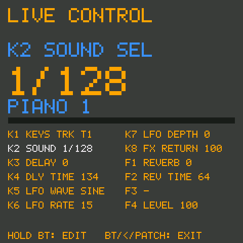
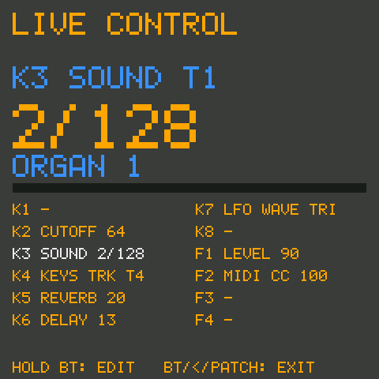
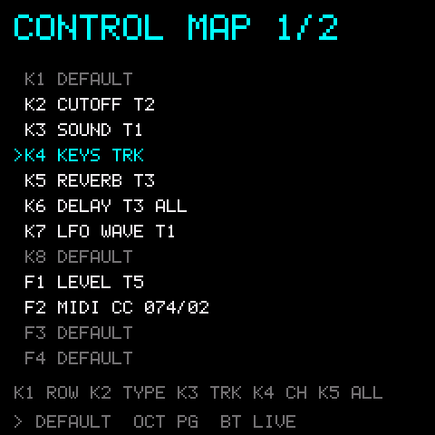
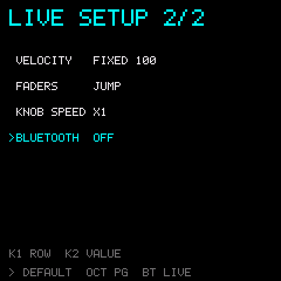
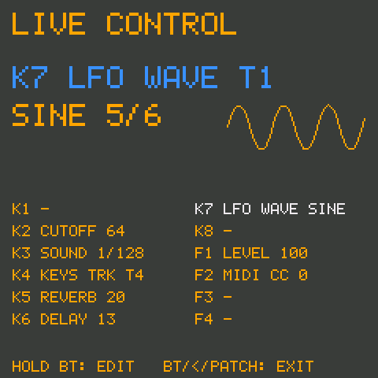
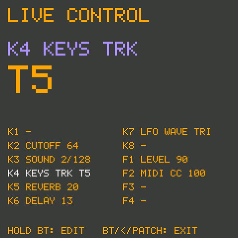
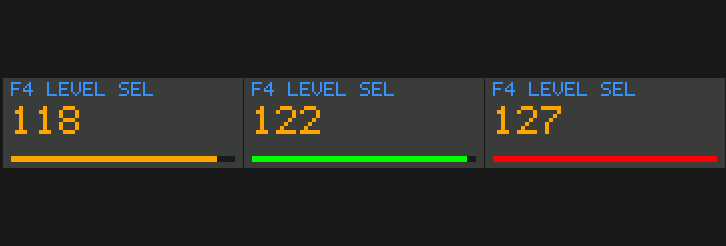

# Screenshots — LIVE CONTROL

Captured from the simulator (same code as the firmware). The screen is 240×240; images are shown at 2×.

### LIVE page — default layout
Each knob/fader and its current value. The readout label and sound name take the track's colour.

### SOUND
Number, `n/max`, and the sound name under the big value.

### CONTROL MAP (editing)
K1 row, K2 type, K3 track/CC, K4 channel, K5 LIVE/ALL.

### LIVE SETUP
Velocity, faders, knob speed, Bluetooth ON/OFF.

### LFO preview
Shape, 1–6 cycles from RATE, height from DEPTH.

### KEYS TRK
The knob chooses which track the keys play.

### Keyboard-volume bar colours
Amber, then green within 5% of max, red at max.

